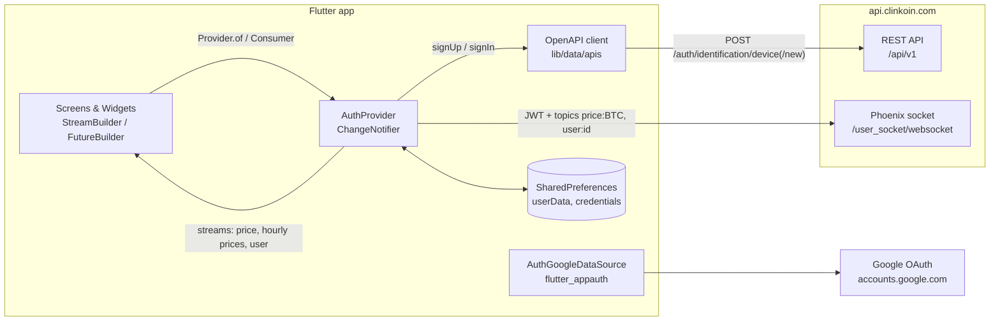
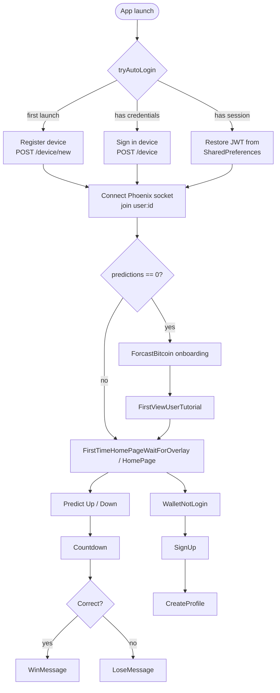

# Clinkoin

A Flutter mobile app for **Bitcoin price forecasting**. Users predict whether BTC will go **up or down** over a chosen time frame, watch the live price stream in, and earn Bitcoin (satoshi) rewards for correct predictions. The app talks to the Clinkoin backend over a **REST API** (generated from an OpenAPI spec) for device authentication and over **Phoenix WebSocket channels** for real-time prices and user data.

## Table of Contents

- [Tech Stack](#tech-stack)
- [Architecture](#architecture)
- [Services](#services)
- [Repository Structure](#repository-structure)
- [Getting Started](#getting-started)
- [Screens and Patterns](#screens-and-patterns)
- [App Flow at a Glance](#app-flow-at-a-glance)
- [Known Issues](#known-issues)

## Tech Stack

| Layer              | Technology                                                                 |
| ------------------ | -------------------------------------------------------------------------- |
| Framework          | Flutter (Dart SDK `>=2.7.0 <3.0.0`, pre–null safety)                       |
| Platforms          | Android (`com.clinkoin`, minSdk 16, targetSdk 30), iOS                     |
| State management   | `provider` (`ChangeNotifier` + `MultiProvider` / `Consumer`)               |
| Real-time data     | `phoenix_socket` (Elixir Phoenix channels over WebSocket)                  |
| HTTP / REST        | `http`, client generated with OpenAPI Generator 5.1.0                      |
| Authentication     | Device-based JWT auth (`jwt_decode`), Google OAuth via `flutter_appauth`   |
| Local storage      | `shared_preferences`                                                       |
| Device identity    | `device_info`, `uuid`, `random_string`                                     |
| UI                 | Material, `flutter_svg`, `flutter_swiper`, `carousel_slider`, `CustomPainter` charts |
| Timers             | `circular_countdown_timer`, `countdown_flutter`, `time_formatter`          |
| Formatting         | `intl`                                                                     |
| Font               | IRANSans (`assets/fonts/IRANSans.ttf`)                                     |
| Testing            | `flutter_test`, `integration_test`                                         |

## Architecture

The app is a single Flutter project with a thin **data layer** (generated API client, data sources, a provider) and a **presentation layer** (screens and reusable widgets). One `AuthProvider` sits at the root of the widget tree. It handles authentication and owns the WebSocket connection, and it exposes the incoming data as broadcast `Stream`s that screens consume with `StreamBuilder`.



### Layers

```
lib/
├── main.dart              # App entry: MultiProvider, theme, auto-login, named routes
├── data/
│   ├── apis/              # OpenAPI-generated REST client (do not edit by hand)
│   │   ├── api.dart           # Library root (part files)
│   │   ├── api_client.dart    # HTTP client, basePath = http://api.clinkoin.com/api/v1
│   │   ├── api/               # AuthenticationApi, ClientApi
│   │   ├── auth/              # ApiKey, HTTP Basic, Bearer, OAuth helpers
│   │   └── model/             # Device, DeviceDevice, User, Error
│   ├── datasource/        # AuthGoogleDataSource (Google sign-in via AppAuth)
│   └── providers/         # AuthProvider: auth, token expiry, Phoenix socket & channels
├── models/                # Plain UI models (Feature)
├── screens/               # Full pages, each exposing a static routeName
├── socket/                # Earlier stand-alone channel class (now commented out)
└── widgets/               # Reusable UI: graphs, win/lose dialogs, buttons
```

## Services

| Service                 | Endpoint                                              | Used by                       | Description                                                                   |
| ----------------------- | ----------------------------------------------------- | ----------------------------- | ----------------------------------------------------------------------------- |
| Clinkoin REST API       | `http://api.clinkoin.com/api/v1`                      | `AuthProvider`, `ClientApi`   | Device sign-up/sign-in, referral codes.                                       |
| ↳ Register device       | `POST /auth/identification/device/new`                | `AuthProvider.signUpp`        | First launch: registers a generated device ID/token and returns `{id, jwt}`.  |
| ↳ Sign in device        | `POST /auth/identification/device`                    | `AuthProvider.signIn`         | Gets a new JWT for an already registered device.                              |
| ↳ Referral code         | `GET /client/set_referral_code/{code}`                | `ClientApi`                   | Applies a referral code to the current user.                                  |
| Phoenix WebSocket       | `ws://api.clinkoin.com/user_socket/websocket`         | `AuthProvider`                | Real-time channels, authenticated with the JWT (`vsn: 2.0.0`).                |
| ↳ `price:BTC` channel   | events `price:momentary`, `price:btc_one_hour`        | Tutorial, Home, Forecast      | Live BTC price (about every second) and hourly close prices for the chart.    |
| ↳ `user:<id>` channel   | push `user:get:question`, reply `phx_reply`           | `main.dart`, Home             | User data, such as the prediction count that picks the first screen.          |
| Google OAuth            | `https://accounts.google.com`                         | `AuthGoogleDataSource`        | Optional Google sign-in (`email`, `profile`) with the redirect `com.clinkoin:/oauth2redirect`. |

API docs for the generated client live in [`doc/`](doc/) (`AuthenticationApi.md`, `ClientApi.md`, `Device.md`, `User.md`, ...).

## Repository Structure

```
Clinkoin/
├── lib/                    # Application source (see Layers above)
├── assets/
│   ├── fonts/IRANSans.ttf  # App font
│   └── images/             # SVG/PNG icons and illustrations (bitcoin, wallet, alien, cup, ...)
├── android/                # Android host project (Kotlin MainActivity)
├── ios/                    # iOS host project (Swift AppDelegate)
├── test/                   # Generated API/model tests + widget test
├── integration_test/       # integration_test driver and app test
├── manual_package/chart/   # Local Flutter package scaffold (not wired into the app yet)
├── doc/                    # OpenAPI-generated API documentation
├── .openapi-generator/     # Generator metadata (version 5.1.0, file list)
├── .vscode/launch.json     # Launch configs for the app and the chart package
├── .travis.yml             # Generated CI config for the API client
├── git_push.sh             # Generated helper script from OpenAPI Generator
└── pubspec.yaml            # Dependencies and asset declarations
```

## Getting Started

### Prerequisites

- [Flutter SDK](https://docs.flutter.dev/get-started/install) **2.x** with a Dart SDK below 3.0. The code isn't null-safe and uses APIs that later Flutter versions removed (for example `TextTheme.body1`), so Flutter 3.x won't build it as-is.
- Android Studio with the Android SDK, or Xcode and CocoaPods for iOS
- An emulator, simulator, or physical device
- Git

> Tip: use [FVM](https://fvm.app/) to pin an older Flutter version for this project without changing your global SDK.

### Clone

```bash
git clone <repo-url>
cd Clinkoin
```

### Fix the Android config file names

Some Android config files are committed with a `.txt` suffix. Rename them before you build:

```bash
mv android/gradle.properties.txt android/gradle.properties
mv android/gradle/wrapper/gradle-wrapper.properties.txt android/gradle/wrapper/gradle-wrapper.properties
mv android/local.properties.txt android/local.properties   # then point sdk.dir / flutter.sdk to your machine
```

### Install and run

```bash
flutter pub get
flutter devices          # list available devices
flutter run              # run on the selected device
```

The app needs network access to `api.clinkoin.com`. On first launch it registers the device automatically, so there's no manual sign-up step.

### Useful commands

| Command                                                                                     | Description                                  |
| ------------------------------------------------------------------------------------------- | -------------------------------------------- |
| `flutter run`                                                                               | Run in debug mode with hot reload            |
| `flutter build apk`                                                                         | Build a release APK for Android              |
| `flutter build ios`                                                                         | Build the iOS app (macOS only)               |
| `flutter test`                                                                              | Run unit and widget tests in `test/`         |
| `flutter drive --driver integration_test/driver.dart --target integration_test/app_test.dart` | Run the integration test on a device        |

### Regenerate the API client

The `lib/data/apis` folder was generated with **OpenAPI Generator 5.1.0** (Dart client). To regenerate it from an updated spec:

```bash
npx @openapitools/openapi-generator-cli generate \
  -i <path-to-openapi-spec.yaml> \
  -g dart \
  -o <output-dir>
```

Then copy the generated `lib/` contents into `lib/data/apis/`. List any files you don't want overwritten in `.openapi-generator-ignore`.

## Screens and Patterns

### Entry point (`lib/main.dart`)

**Patterns implemented**
- **`MultiProvider`** with a single `ChangeNotifierProvider` for `AuthProvider`
- **`FutureBuilder`** around `auth.tryAutoLogin()`, which shows a loading screen while authenticating
- **`StreamBuilder`** on `auth.onEventsGetUser` to choose the first screen: new users (`0` predictions) see `ForcastBitcoin` onboarding, and everyone else goes to `FirstTimeHomePageWaitForOverlay`
- **Named routes**: every screen exposes a `static routeName` that is registered in `MaterialApp.routes`
- **Custom page transition** (`MyApp.createRoute`) with a `SlideTransition` from the right
- Global **IRANSans** theme font and shared font-size constants

### AuthProvider (`lib/data/providers/auth_provider.dart`)

**Patterns implemented**
- **Device-based authentication**: generates a `uuid` device ID and a random device token, registers them, and stores the returned JWT
- **Auto-login state machine** in `tryAutoLogin()`:
  - no stored data → **sign up**
  - credentials but no session → **sign in**
  - full session → **restore** from `SharedPreferences`
- **JWT expiry handling**: decodes `exp` with `jwt_decode` and schedules `_autoLogout()` with a `Timer`
- **Phoenix channels**: connects the socket with the JWT, then joins `price:BTC` and `user:<id>`
- **Broadcast `StreamController`s** (`onEventsMomentaryPrice`, `onEventsHourlyPrice`, `onEventsGetUser`), so several widgets can listen to the same feed

### Screens (`lib/screens`)

| Screen                              | Route                                | Purpose                                                                      |
| ----------------------------------- | ------------------------------------ | ---------------------------------------------------------------------------- |
| `ForcastBitcoin`                    | `/forcast_bitcoin`                   | Onboarding swiper: "Forcast Bitcoin", "Win Bitcoin", "Wallet".               |
| `FirstViewUserTutorial`             | `/FirstViewUserTutorial`             | Guided first prediction showing the live price and hourly chart.             |
| `FirstViewUserTutorialPredicted`    | `/FirstTimeUserTutorialPredicted`    | Tutorial step after the first prediction is placed.                          |
| `FirstTimeHomePageWaitForOverlay`   | `/FirstTimeHomePageWaitForOverlay`   | Home with a circular countdown while a prediction resolves, then a win/lose dialog. |
| `HomePage`                          | `/HomePage`                          | Main dashboard: BTC price, 1H / 1D / 1W / 1M ranges, "Going Up" / "Going Down", Watch Live, Global Battle (coming soon). |
| `PredictedUndo`                     | `/PredictedUndo`                     | Active prediction with a countdown and an option to undo.                    |
| `WalletNotLogin`                    | `./WalletNotLogin`                   | Wallet view for guests, with prompts to sign up.                             |
| `SignUp`                            | `/SignUp`                            | Sign-up options (Google, email, Twitter).                                    |
| `CreateProfile`                     | `/CreateProfile`                     | Profile creation after sign-up, then on to `HomePage`.                       |
| `FeedBack`                          | `/FeedBack`                          | Feedback / support page.                                                     |

### Widgets (`lib/widgets`)

- **`LineGraph`** (`draw_graph.dart`) and **`LineGraphPainter`** (`lineGraph.dart`): a custom BTC price chart drawn with **`CustomPainter`**, with no chart library involved
- **`WinMessage` / `LoseMessage`**: result dialogs shown when a prediction resolves
- **`TimeButton`**: a stateful time-frame selector
- **`SharedLongButton`**: a reusable full-width call-to-action button

## App Flow at a Glance



## Known Issues

- **Old Flutter/Dart toolchain.** The project predates null safety and requires Dart `<3.0.0`. Use a Flutter 2.x SDK.
- **Android config files have a `.txt` suffix.** `gradle.properties`, `local.properties`, and `gradle-wrapper.properties` must be renamed (see [Getting Started](#fix-the-android-config-file-names)). The Gradle wrapper scripts (`gradlew`) aren't committed either. Running `flutter build` / `flutter run` recreates them.
- **iOS project files have an `.xml` suffix** (for example `Main.storyboard.xml` and `contents.xcworkspacedata.xml`). Rename them, or run `flutter create .` to regenerate the iOS host project.
- **Duplicate `(1)` files.** `lib/screens`, `lib/socket`, and `lib/widgets` contain copies such as `home_page(1).dart` that differ only in line endings. They're unused and can be deleted.
- **`build/` and `.dart_tool/` are committed.** These are generated folders and should be removed from git and added to `.gitignore`.
- **IRANSans font isn't declared.** The theme uses `fontFamily: 'IRANSans'`, but `pubspec.yaml` has no `fonts:` entry, so Flutter falls back to the default font.
- **Placeholder tests.** `integration_test/app_test.dart` and `test/widget_test.dart` are still the default counter templates, and the generated API tests are empty stubs.
- **`manual_package/chart`** is an unused package scaffold. It still contains the template `Calculator` class.
- **Unencrypted endpoints.** The REST API and WebSocket use `http://` and `ws://`. Production should use `https://` and `wss://`.
- **Hard-coded data on the home page.** Values such as the balance (`220 SATOSHI`), price, and 24h change in `HomePage` are static placeholders and aren't yet bound to the socket streams.
- **Sensitive values in comments.** `auth_google_data_source.dart` and `auth_provider.dart` contain commented-out sample tokens. Remove them, and keep OAuth client IDs in config rather than in source.
